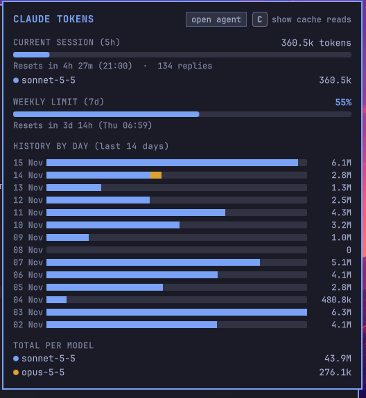

# Claude Tokens

An Omarchy bar widget that shows your Claude Code token consumption:



- **Current session (5h):** tokens spent, a progress bar, time until the session resets, and the split per model. The reset time comes from Anthropic's own usage record when available, otherwise from the first message of the window.
- **History by day:** stacked bars per Claude model for the last N days (default 14).
- **Total per model** over the same period.
- The weekly limit and its reset, when known.

Click the bar icon to open the panel. The **open agent** button starts your default coding agent in a terminal (`omarchy agent`). `c` toggles cache-read tokens (hidden by default, they dwarf everything else), `r` refreshes, Esc closes.

Everything is computed locally from `~/.claude/projects/**/*.jsonl`. No network access. The collector only runs while the panel is open, and caches per-file results in `~/.cache/claude-usage-plugin.json`.

Secondary text is derived from the theme's text colour (75% opacity, about 5:1 contrast on dark themes) instead of the theme's `muted` colour, which is often too faint to read comfortably.

For limit percentages and pacing, see [claudebar](https://github.com/mryll/claudebar); the two complement each other.

## Install

```bash
omarchy plugin add https://github.com/rodrigondec/omarchy-claude-tokens.git --enable
```

## Remove

```bash
omarchy plugin disable io.github.rodrigondec.claude-tokens
omarchy plugin remove io.github.rodrigondec.claude-tokens
```

## Settings

History days (7-60), under Setup → Plugins or the widget's entry in `shell.json`.

## Requirements

`python3` and Claude Code (for the session records).
